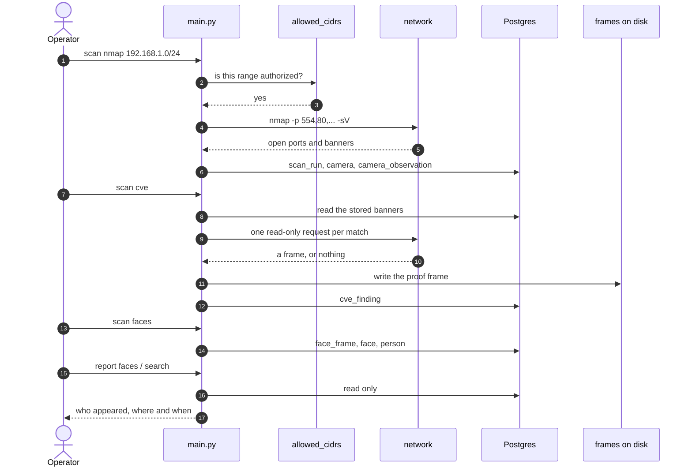
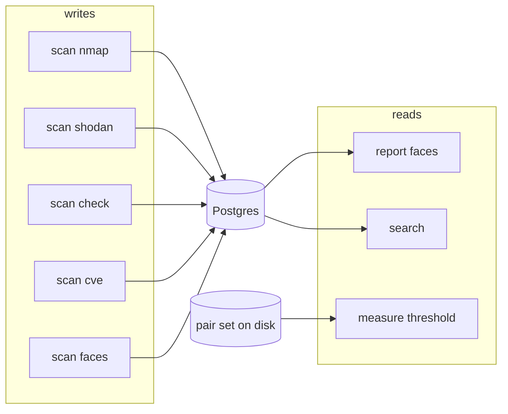
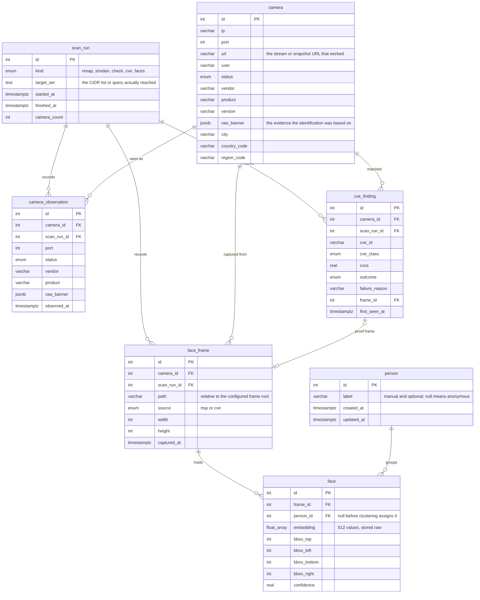

<div align="center">

# Camera Scanner

**Find the cameras on a network you own, read one frame through the path that
works, match that camera against a CVE feed, read the faces in the frame, group
the faces into people, and answer who appeared, on which camera, and when.**

[](https://github.com/iklobato/shodan_rtsp/actions/workflows/ci.yml)

[](https://hub.docker.com/r/iklob1/shodan-rtsp)


[Quickstart](#quickstart) · [The seven commands](#the-seven-commands) ·
[Data model](#data-model) · [Troubleshooting](#troubleshooting) ·
[All docs](#where-the-rest-of-the-documentation-lives)

</div>


That recording is a real run of this machine on 2026-11-11, against the lab
Postgres. Replay it with `asciinema play docs/demo.cast`, or read it as text with
`asciinema cat docs/demo.cast`.

> [!WARNING]
> **Authorized use only.** This tool logs into cameras and reads frames from them.
> Run it only against devices you own or have **explicit written authorization** to
> test: your own lab, or an engagement with a defined scope. Reaching a camera you
> do not control is unauthorized access, and recording from it is interception.
> Both are illegal in most places. `targets.allowed_cidrs` is the authorization
> written down once, and it is empty by default: an empty list authorizes nothing.
>
> The CVE path is read-only by construction. It pulls at most one frame per match,
> sends no payload, and writes nothing to the device (D9, D30). Nothing in this
> repository is a weaponized exploit.
>
> Faces are read from frames the pipeline already obtained, and the people they are
> grouped into stay anonymous: a person is an id until an operator names it by hand
> (D28). Do not point this at people who did not agree to it.

---

## At a glance

| | |
|---|---|
| **Input** | a CIDR you own, plus `config.yaml` |
| **Output** | Postgres rows, JPEG frames on disk, three read-only reports |
| **Reaches the network** | `scan nmap`, `scan shodan`, `scan check`, `scan cve`, `scan faces` |
| **Never reaches the network** | `report faces`, `search`, `measure threshold` |
| **Writes to a device** | never. One frame read per match, no payload, no config push |
| **Names a person** | never automatically. A person is an id until a human labels it |
| **Hard dependency** | Python 3.11, Postgres, `nmap`, `ffmpeg` for RTSP frames |
| **Soft dependency** | `mediamtx` for the lab, `~/.insightface/models/buffalo_l` for faces |

### What it does, and what it does not

| Stage | Does | Does not |
|-------|------|----------|
| `scan nmap` | sweeps 7 camera ports, stores one row per open port | guess credentials, open a stream |
| `scan check` | tries `url x user x password`, records what worked, stores one frame | retry a locked device, brute-force outside the wordlist |
| `scan cve` | matches stored banners against NVD, reads one frame per match | send an exploit, write to the device |
| `scan faces` | detects faces, clusters them into people, writes frame files | label a person, keep a face that failed detection |
| `report` / `search` | print what is stored | touch the network at all |

---

## Quickstart

| # | Step | Command |
|---|------|---------|
| 1 | Install dependencies | `uv sync` |
| 2 | Start Postgres 16 on port 5440 | `docker compose up -d postgres` |
| 3 | Create the config and edit it | `cp config.yaml.example config.yaml` |
| 4 | Create the schema | `uv run alembic upgrade head` |
| 5 | Sweep your lab | `uv run python main.py scan nmap 127.0.0.1/32` |
| 6 | Read the result | `uv run python main.py report faces` |

Real terminal, this machine, 2026-11-11:

```console
$ uv sync
$ docker compose up -d postgres
[+] Running 1/1
 ✔ Container shodan_pg  Started

$ uv run alembic current
INFO  [alembic.runtime.migration] Context impl PostgresqlImpl.
0002 (head)

$ uv run python main.py --help
usage: main.py [-h] [--config CONFIG] [-v] {scan,report,search,measure} ...

Camera Scanner

positional arguments:
  {scan,report,search,measure}
    scan                Scans that write to the database
    report              Read-only reports
    search              Who appeared, where and when
    measure             Measurements that write nothing

options:
  -h, --help            show this help message and exit
  --config CONFIG       Path to the configuration file
  -v, --verbose         Verbose mode
```

The full lab runbook, with the devices to point this at, is
[`quickstart.md`](specs/001-camera-monitoring-pipeline/quickstart.md).

---

## One run, end to end



Every stage in the order an operator runs it, with real output from one lab run.

### 1. Sweep

```console
$ uv run python main.py scan nmap 192.168.1.0/24
2026-11-11 13:47:01,729 INFO Starting nmap scanning on 192.168.1.0/24
2026-11-11 13:48:01,022 INFO Found 5 hosts using nmap scan
2026-11-11 13:48:01,024 INFO nmap XML written to logs/nmap.xml
2026-11-11 13:48:01,149 INFO Executors: finished nmap scan
```

A host that answers with the port closed is not a camera and is not stored. One
`scan_run` row records the range, so the record of what a run touched is written
even when nobody typed the range this time.

### 2. The gate, when the range is not authorized

```console
$ uv run python main.py scan check
2026-11-11 13:39:34,552 INFO Starting check task
2026-11-11 13:39:34,751 ERROR 224 of 226 addresses are outside the declared ranges
  ['127.0.0.1/32', '192.168.1.0/24']: 190.120.45.220, 189.15.27.223, ...
  and 214 more; declare them in targets.allowed_cidrs, or narrow the run with --camera-id
```

Nothing was sent. Narrow the run to the camera you named:

```console
$ uv run python main.py scan check --camera-id 232
2026-11-11 13:40:34,977 INFO Executors: finished testing cameras
```

### 3. Read one frame through a CVE class

```console
$ uv run python main.py -v scan cve --camera-id 231
2026-11-11 13:42:21,860 INFO Starting the CVE task
2026-11-11 13:42:22,175 INFO 127.0.0.1:8000 matches 1 CVE(s)
2026-11-11 13:42:22,219 INFO CVE read GET http://127.0.0.1:8000/onvif-http/snapshot?auth=...
2026-11-11 13:42:22,316 INFO Executors: finished the CVE task
$ ls -l logs/frames/231/
-rw-r--r--  22096  20261111T164222Z-cve.jpg
```

Exit 0 even when no frame comes back: a recorded absence is a successful run, not
a failure. The `cve_finding` rows carry the outcome and the reason. The rest of
the feed build and the CPE map is in [CVE matching](docs/cve-matching.md).

### 4. Faces into people

```console
$ uv run python main.py scan faces --camera-id 231
2026-11-11 12:45:33,379 DEBUG face 1 joined person 1
2026-11-11 12:45:33,708 DEBUG face 2 joined person 1
2026-11-11 12:45:34,103 DEBUG face 3 joined person 2
2026-11-11 12:45:34,104 INFO 127.0.0.1:8000 holds 3 face(s)
```

Three faces in three frames became two people: faces 1 and 2 are the same person
in two frames of one camera, face 3 is someone else. Nothing is labelled. A face
that matches two people merges them, the older person wins, and every face and
frame of both is kept (D35).

The threshold that decides two faces are one person ships as a placeholder, and
[measuring it](docs/face-threshold.md) is the one number in the tool that nobody
can guess for you.

### 5. Answer

```console
$ uv run python main.py report faces
person 1  faces 22  first seen 2026-11-11T15:45:04Z  last seen 2026-11-11T16:42:22Z
  camera 127.0.0.1:8000  frames 5  frame cve
  camera 127.0.0.1:8554  frames 17  frame rtsp
person 2  faces 2   first seen 2026-11-11T15:45:23Z  last seen 2026-11-11T15:45:23Z
  camera 127.0.0.1:8000  frames 2  frame cve
```

---

## Install

Dependencies use [uv](https://docs.astral.sh/uv/). `pyproject.toml` is the single
source and `uv.lock` pins exact versions.

```bash
git clone https://github.com/iklobato/shodan_rtsp
cd shodan_rtsp
uv sync                       # creates .venv, installs runtime and dev deps from the lock
```

`uv` provisions Python 3.11 itself if missing (see `.python-version`). To install
with plain pip, export a requirements file first:
`uv export --no-hashes --no-dev -o requirements.txt`.

| Piece | Why | Check |
|-------|-----|-------|
| `nmap` | the sweep, and the banner that names a brand | `nmap --version` |
| `ffmpeg` | RTSP capture and the lab stream | `ffmpeg -version` |
| Docker | Postgres 16 on port 5440 | `docker compose ps` |
| `mediamtx` | only for the lab target | `mediamtx --help` |
| `buffalo_l` | face model, about 280 MB, downloads on first face run | `ls ~/.insightface/models` |

### The database

```bash
docker compose up -d postgres
docker compose ps              # wait for healthy
uv run alembic upgrade head    # creates every table; a second run changes nothing
uv run alembic current         # 0002 (head)
```

| Command | Effect |
|---------|--------|
| `docker compose up -d postgres` | starts Postgres 16, data in a named volume |
| `docker compose down` | stops it, keeps data |
| `docker compose down -v` | stops it and wipes the volume |

Port 5432 and 5433 were taken on the machine this was built on, so the service
listens on 5440 (D40).

### Or run the published image

The image is the CLI, so a run needs no source tree and no build:

```bash
export SHODAN_IMAGE=iklob1/shodan-rtsp:0.1.0
docker run --rm \
  -v "$PWD/config.yaml:/app/config.yaml:ro" \
  -e DATABASE_HOST=host.docker.internal:5440 \
  "$SHODAN_IMAGE" report faces
```

[Run it in Docker](docs/docker.md) covers the tags, the compose service, what is
in the image, nmap as a non-root user, and how a release is published.

### The lab target

Two devices, both local, both fake:

```text
                 your Mac                       the pipeline sees
   ┌────────────────────────────────┐
   │ ffmpeg  ──publish──► mediamtx  │  rtsp://127.0.0.1:8554/h264/ch1/main/av_stream
   │                      :8554     │
   │                                │
   │ lab/mock_camera.py :8000       │  http://127.0.0.1:8000/onvif-http/snapshot?auth=...
   └────────────────────────────────┘
```

```bash
# RTSP side
mediamtx lab/mediamtx.yml &
ffmpeg -loop 1 -re -i logs/faces/friends/01.jpg \
  -vf "scale=trunc(iw/2)*2:trunc(ih/2)*2" \
  -r 10 -c:v libx264 -pix_fmt yuv420p -g 10 -f rtsp -rtsp_transport tcp \
  rtsp://127.0.0.1:8554/h264/ch1/main/av_stream

# CVE side
uv run python lab/mock_camera.py --port 8000 --image logs/faces/friends/01.jpg \
  2> logs/mock_camera.log
```

Two details cost a run each: libx264 refuses an odd width or height (hence the
`scale`), and `-stream_loop -1` does not loop an image input (hence `-loop 1 -re`).
Verify both before scanning:

```console
$ curl -s -o /tmp/snap.jpg -w '%{http_code}\n' \
  "http://127.0.0.1:8000/onvif-http/snapshot?auth=YWRtaW46MTEK"
200
$ file -b /tmp/snap.jpg
JPEG image data, JFIF standard 1.01, 239x279, components 3

$ ffprobe -v error -rtsp_transport tcp -show_entries stream=codec_name,width,height \
    -of csv=p=0 rtsp://127.0.0.1:8554/h264/ch1/main/av_stream
h264,238,278
```

The mock is not vendor firmware. It answers the snapshot path with a JPEG, 404 to
everything else, and sends `Server: Hikvision-Webs/DS-2CD2032-I` so a real
`nmap -sV` names the brand and model.
[`docs/front-4-rig.md`](docs/front-4-rig.md) records what that leaves unproved.

---

## The seven commands

```bash
uv run python main.py [--config PATH] [-v] <group> <command> [options]
```



| Command | Reaches network | Writes | One line |
|---------|-----------------|--------|----------|
| `scan nmap [CIDR]` | nmap over the range | `scan_run`, `camera`, `camera_observation` | find cameras |
| `scan shodan [QUERY]` | Shodan API | same as nmap | find cameras without touching them ([by location](docs/shodan-by-location.md)) |
| `scan check [--camera-id N]` | RTSP port of stored cameras | `camera.url`, `user`, `password`, `status` | get in |
| `scan cve [--camera-id N]` | HTTP, ONVIF, RTSP of stored cameras | `cve_finding`, one proof frame | read one frame per match |
| `scan faces [--camera-id N]` | stored camera URL, only if no frame | `scan_run`, `face_frame`, `face`, `person` | who is in the frame |
| `report faces [--person-id N]` | none | nothing | the answer |
| `search [filters]` | none | nothing | the answer as a timeline |
| `measure threshold [--pairs P]` | none | nothing, not even the config | [the one number to trust](docs/face-threshold.md) |

`--config` and `-v` come before the group: `main.py --config lab.yaml scan nmap`.

### `search` filters

| Flag | Takes | Example |
|------|-------|---------|
| `--person-id` | integer | `--person-id 1` |
| `--camera-id` | integer | `--camera-id 231` |
| `--since` | ISO 8601, read as UTC | `--since 2026-11-11T00:00:00Z` |
| `--until` | ISO 8601, read as UTC | `--until 2026-11-11T23:59:59Z` |

All four combine with AND.

---

## Exit codes

| Code | Meaning | Example |
|------|---------|---------|
| `0` | the command completed, including a run that found nothing | `scan cve` with no frame |
| `1` | a refusal the operator can fix, printed with its reason | target outside the range, unknown camera id, a timestamp that is not one |
| `2` | the command line itself is wrong | `main.py scan` with no command |

```console
$ uv run python main.py search --since nope
2026-11-11 13:52:46,290 ERROR nope is not a timestamp: Invalid isoformat string: 'nope'
$ echo $?
1
```

A finding of nothing is exit 0 with output that says so, so a caller can tell
"nothing there" apart from "it broke".

| Stream | Carries |
|--------|---------|
| stderr | log lines, one per network step, before the call |
| stdout | results, so they pipe |

No credential value appears in any log line at any level (FR-030).

---

## The monitoring answer

### `report faces`

```console
$ uv run python main.py report faces
person 1  faces 22  first seen 2026-11-11T15:45:04Z  last seen 2026-11-11T16:42:22Z
  camera 127.0.0.1:8000  frames 5  frame cve
  camera 127.0.0.1:8554  frames 17  frame rtsp
person 2  faces 2   first seen 2026-11-11T15:45:23Z  last seen 2026-11-11T15:45:23Z
  camera 127.0.0.1:8000  frames 2  frame cve
```

```text
person 1  faces 22  first seen ...  last seen ...
│
├── camera 127.0.0.1:8000   frames 5    frame cve     ┐ how many frames
└── camera 127.0.0.1:8554   frames 17   frame rtsp    ┘ and which path found them
```

`--person-id N` narrows it to one person.

### `search`

```console
$ uv run python main.py search --since 2026-11-11T00:00:00Z
2026-11-11T15:45:04Z  person 1  camera 127.0.0.1:8000  frame cve
2026-11-11T15:45:14Z  person 1  camera 127.0.0.1:8000  frame cve
2026-11-11T15:45:23Z  person 2  camera 127.0.0.1:8000  frame cve
2026-11-11T15:52:06Z  person 1  camera 127.0.0.1:8554  frame rtsp
2026-11-11T16:42:22Z  person 1  camera 127.0.0.1:8000  frame cve
```

One line per appearance, oldest first. A person with no label prints as
`person <id>`, never as a name, because nothing labels a person automatically
(D28).

---

## Data model

Seven entities. Frames are files, the database holds the path (D17).



| File | Role |
|------|------|
| `models/camera.py`, `models/observation.py`, `models/frame.py`, `models/finding.py`, `models/face.py`, `models/person.py`, `models/scan_run.py` | the seven entities |
| `models/database.py` | `Database` owns the engine and a transactional `session_scope` (commit on success, roll back on error, always close) |
| `models/managers.py` | one repository per entity, the only place that queries a table; the reports read through `PersonReader`, which cannot write |
| `migrations/versions/` | `0001_initial_schema`, `0002_migrate_legacy_cam` |

---

## Troubleshooting

Every row below is a real failure seen while building this, with the real answer.

| Symptom | Cause | Fix |
|---------|-------|-----|
| sweep finds 5 hosts, zero cameras | hosts answer ICMP but no camera port is open | `nmap -Pn -p 554,80,... /24` to skip host discovery, and check the ARP table |
| devices appear in ARP but every port is `filtered` | MAC is randomized: a phone or laptop with a firewall | not a camera, ignore |
| ARP shows only the router | guest SSID or client isolation separates the clients | move the camera to the main SSID |
| camera not in ARP at all | no DHCP lease: it sits on its factory IP, or never associated | try `192.168.1.64` (Hikvision), `192.168.1.108` (Dahua) |
| `scan check` refuses 224 addresses | stored cameras from an earlier run are outside `allowed_cidrs` | `--camera-id N`, or declare the range |
| `bind: address already in use` on 5440 | another Postgres holds the port | `docker compose down`, or change `database.host` |
| `libx264` refuses the frame | odd width or height | `-vf "scale=trunc(iw/2)*2:trunc(ih/2)*2"` |
| ffmpeg publishes one frame then stops | `-stream_loop -1` does not loop an image input | `-loop 1 -re` |
| `method DESCRIBE failed: 404` | the RTSP path does not exist on that server | use the path the server publishes, not a wordlist guess |
| face scan finds nothing | the frame has no face, or the model is missing | check the JPEG by hand, then `ls ~/.insightface/models` |

Quick reachability check, no scanner involved:

```console
$ ping -c1 192.168.1.64
$ nc -vz 192.168.1.64 554 80
$ ffprobe -v error rtsp://192.168.1.64:554/Streaming/Channels/101
```

---

## Development

| Task | Command |
|------|---------|
| Tests (DB and network faked) | `uv run pytest -q` |
| Lint | `uv run ruff check .` |
| Add a dependency | `uv add <pkg>` |
| Add a dev dependency | `uv add --dev <pkg>` |

```console
$ uv run pytest -q
144 passed in 18.18s
$ uv run ruff check .
All checks passed!
```

The tests run against an in-memory SQLite database and injected fakes, so the
whole suite passes with no Postgres, no camera and no network. The one exception
is the migration suite, which needs a real PostgreSQL for the DDL:
[`.github/workflows/ci.yml`](.github/workflows/ci.yml) starts a throwaway one and
writes a `config.yaml` from the example, with placeholder credentials, so those
tests run in CI instead of skipping. On this machine
`docker compose up -d postgres` is what makes them run, and they skip with the
reason when the lab is not there.

The code follows an OO/SOLID structure: one type per concept, strategies behind
`typing.Protocol`, dependency injection at the composition root (`main.py`),
context managers over `try/finally`, and dispatch tables over `if/elif`.

Configuration, every key and every note, is in
[Configuration](docs/configuration.md). All settings and keys live in one
git-ignored `config.yaml`; start from `cp config.yaml.example config.yaml`.

---

## Where the rest of the documentation lives

| Document | Holds |
|----------|-------|
| [Run it in Docker](docs/docker.md) | tags, compose service, what is in the image, publishing a release, the first release as it went |
| [Shodan by location](docs/shodan-by-location.md) | the range gate, the location filters, what gets stored |
| [CVE matching](docs/cve-matching.md) | building the NVD feed, the CPE map, the gotchas |
| [Measure the face threshold](docs/face-threshold.md) | the pair set, the separation, where to put the number |
| [Configuration](docs/configuration.md) | every key of `config.yaml` with its note |
| [`docs/demo.cast`](docs/demo.cast) | the recording behind the GIF at the top, replayable |
| [`docs/decisions/2026-11-11-shodan-rtsp-prod-ready.md`](docs/decisions/2026-11-11-shodan-rtsp-prod-ready.md) | the 43 settled decisions |
| [`.specify/memory/constitution.md`](.specify/memory/constitution.md) | the binding rules of this repository |
| [`specs/001-camera-monitoring-pipeline/`](specs/001-camera-monitoring-pipeline/) | spec, plan, research (R1 to R11), data model, CLI contract, lab runbook |
| [`docs/KNOWLEDGE.md`](docs/KNOWLEDGE.md) | dated session log, newest section first |
| [`docs/front-*.md`](docs/front-1-report.md) | what each front proved, with raw output |

---

## Disclaimer

This is a security research tool. It is provided as is, with no warranty. The
author is not responsible for misuse, for damage caused by a run, or for the legal
consequences of reaching a device you do not own. Reading a frame from a camera you
do not control is unauthorized access and interception in most jurisdictions. The
gate exists to make the authorized range explicit; it does not make a wrong range
legal.

## License

MIT.
