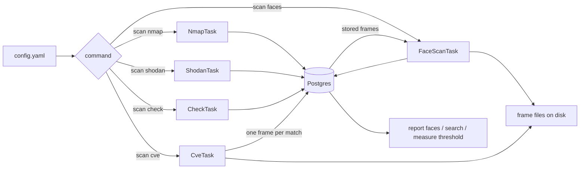

# Camera Scanner


A Python tool for **camera security research on a network you own or have written
authorization to scan**. It finds cameras, reads a frame through the path that
works, matches what it saw against a CVE feed, reads the face in the frame, groups
the faces into people, and answers who appeared, on which camera and when.

Every command that reaches a device is bound to the range declared in
`targets.allowed_cidrs`. A run that would reach one address outside that list is
refused before any packet leaves (FR-001, D18).

> [!WARNING]
> **Authorized use only.** This tool logs into cameras and reads frames from them.
> Use it only against devices you own or have **explicit written authorization** to
> test: your own lab, or an engagement with a defined scope. Reaching a camera you
> do not control is unauthorized access, and recording from it is interception.
> Both are illegal in most places. The `targets.allowed_cidrs` list is the
> authorization written down once, and it is empty by default: an empty list
> authorizes nothing.
>
> The CVE path is read-only by construction. It pulls at most one frame per match,
> it sends no payload, and it writes nothing to the device (D9, D30). Nothing in
> this repository is a weaponized exploit.
>
> Faces are read from frames the pipeline already obtained, and the people they
> are grouped into stay anonymous: a person is an id until an operator names it by
> hand (D28). Do not point this at people who did not agree to it.

---

## Contents

- [Quickstart](#quickstart)
- [How it works](#how-it-works)
- [Installation](#installation)
- [Configuration](#configuration)
- [Usage](#usage)
- [The commands](#the-commands)
- [The monitoring answer](#the-monitoring-answer)
- [Measure the face threshold](#measure-the-face-threshold)
- [CVE matching](#cve-matching)
- [Development](#development)
- [Disclaimer](#disclaimer)
- [License](#license)

---

## Quickstart

| # | Step | Command |
|---|------|---------|
| 1 | Install deps and Postgres | `uv sync` then `docker compose up -d postgres` |
| 2 | Create the config | `cp config.yaml.example config.yaml` |
| 3 | Create the schema (first run only) | `uv run alembic upgrade head` |
| 4 | Scan the lab | `uv run python main.py scan nmap 127.0.0.1/32` |
| 5 | Read the result | `uv run python main.py report faces` |

```bash
uv sync                            # installs into .venv; uv fetches Python 3.11 if needed
docker compose up -d postgres      # Postgres 16 on localhost:5440
cp config.yaml.example config.yaml # edit: targets.allowed_cidrs, database creds
uv run alembic upgrade head        # creates every table; a second run changes nothing
```

Each step is explained below. The full lab runbook, with the device to point this
at, is `specs/001-camera-monitoring-pipeline/quickstart.md`.

---

## How it works

Five scan commands and three read-only commands, one storage layer. Everything
reads from a single `config.yaml`.



The four `scan` commands that reach a device write what they saw. The three
others only read.

| Command | Task | Network egress | Needs the DB |
|---------|------|----------------|--------------|
| `scan nmap` | `NmapTask` | nmap over the target range | yes |
| `scan shodan` | `ShodanTask` | the Shodan API | yes |
| `scan check` | `CheckTask` | the RTSP port of stored cameras | yes |
| `scan cve` | `CveTask` | the HTTP, ONVIF and RTSP ports of stored cameras | yes |
| `scan faces` | `FaceScanTask` | the stored camera URL, only when no frame is stored | yes |
| `report faces` | `PersonReport` | none | yes |
| `search` | `SearchReport` | none | yes |
| `measure threshold` | `ThresholdReport` | none | no |

### The scan commands

- **`scan nmap [target]` (`NmapTask`)**: sweeps the range for the ports of D15
  (554, 80, 443, 8000, 8080, 8554, 34567), stores one `camera` row per address and
  port, one `camera_observation` per port, and one `scan_run` for the sweep. The
  raw XML stays on disk as the record of what nmap saw (`nmap.xml_path`).
- **`scan shodan [query]` (`ShodanTask`)**: runs the Shodan query and stores the
  same rows. The query is validated against `targets.allowed_cidrs` before the API
  call, so a query that names a range outside the declared list fails before any
  API credit is spent. Shodan does not index private space, so this command cannot
  serve a private lab range (D37).
- **`scan check [--camera-id N]` (`CheckTask`)**: tries the
  `url × user × password` combinations from the wordlists against the stored
  cameras, brand specific credentials first, and records what worked. The frame it
  obtained is stored once.
- **`scan cve [--camera-id N]` (`CveTask`)**: reads the stored observations,
  matches them against the CVE map, and for each match tries the read-only classes
  in order until one returns a frame (FR-017). One `cve_finding` per camera and
  CVE, updated in place, plus at most one proof frame per finding.
- **`scan faces [--camera-id N]` (`FaceScanTask`)**: reads the frames the pipeline
  already obtained, detects the faces, and assigns each face to a person. A camera
  that holds no frame is captured over RTSP. Nothing is labelled here.

### Storage

Frames are files on disk and the database holds the path, under
`<frames.root_path>/<camera_id>/<timestamp>-<source>.jpg` (D17, R8).

| File | Role |
|------|------|
| `models/camera.py`, `models/observation.py`, `models/frame.py`, `models/finding.py`, `models/face.py`, `models/person.py`, `models/scan_run.py` | The seven entities of `data-model.md`. |
| `models/database.py` | `Database` owns the engine and a transactional `session_scope` (commit on success, roll back on error, always close). |
| `models/managers.py` | One repository per entity, the only place that queries a table. The reports read through `PersonReader`, which cannot write. |
| `migrations/versions/` | The Alembic migrations: `0001_initial_schema`, `0002_migrate_legacy_cam`. |

---

## Installation

Dependencies use [uv](https://docs.astral.sh/uv/). `pyproject.toml` is the single
source and `uv.lock` pins exact versions.

```bash
git clone https://github.com/iklobato/shodan_rtsp
cd shodan_rtsp
uv sync                       # creates .venv, installs runtime + dev deps from the lock
```

`uv` provisions Python 3.11 itself if missing (see `.python-version`). To install
with plain pip, export a requirements file first:
`uv export --no-hashes --no-dev -o requirements.txt`.

### The database

```bash
docker compose up -d postgres
docker compose ps              # wait for healthy
uv run alembic upgrade head
uv run alembic current
```

The service is `shodan_pg` (postgres 16) on host port 5440, matching the
`database` block of `config.yaml.example`. Port 5432 and 5433 are taken on the
machine this was built on (D40).

| Command | Effect |
|---------|--------|
| `docker compose up -d postgres` | Starts Postgres 16; data stays in a named volume. |
| `docker compose down` | Stops it and keeps data. |
| `docker compose down -v` | Stops it and wipes the volume. |

### The lab device

`scan cve` and `scan faces` need something to read. The runbook in
`specs/001-camera-monitoring-pipeline/quickstart.md` stands up two:

- `mediamtx` plus `ffmpeg` for the RTSP side, so `scan check` has a stream to open.
- `lab/mock_camera.py` for the CVE side. It is a mock, not vendor firmware: it
  answers `GET /onvif-http/snapshot?auth=YWRtaW46MTEK` with a JPEG and 404 to
  everything else, and it sends `Server: Hikvision-Webs/DS-2CD2032-I` so a real
  `nmap -sV` names the brand and the model. `docs/front-4-rig.md` records why
  there is no emulated firmware, and what that leaves unproved.

```bash
uv run python lab/mock_camera.py --port 8000 --image logs/faces/friends/01.jpg \
  2> logs/mock_camera.log
```

The standard library access log on stderr is the device state a run is compared
on: one line per request, and nothing this device accepts is a write. `--image` is
optional; without it the device serves a flat grey frame, which is enough for the
CVE path and not enough for a face.

The face model (`buffalo_l`, about 280 MB) downloads into `~/.insightface/models`
on the first face command.

---

## Configuration

All settings and keys live in one `config.yaml`, which is git-ignored. Start from
the template:

```bash
cp config.yaml.example config.yaml
```

### Settings

| Key | Default in example | What it does |
|-----|--------------------|--------------|
| `shodan.api_key` | placeholder | Shodan API key. |
| `shodan.query` | `net:203.0.113.0/24 screenshot.label:webcam,cam` | Shodan query for `scan shodan`. |
| `targets.allowed_cidrs` | `["203.0.113.0/24"]` | The one list of what this scanner may reach. Empty authorizes nothing. |
| `checkers.wordlist_users` | `wordlists/users_small.txt` | Usernames, one per line. |
| `checkers.wordlist_passwords` | `wordlists/passwords_small.txt` | Passwords, one per line. A blank line means no password. |
| `checkers.wordlist_rtsp_urls` | `wordlists/rtsp_urls_small.txt` | URL templates, one per line. |
| `checkers.randomize` | `true` | Shuffle the credential combinations. |
| `checkers.concurrency` | `1` | Parallel RTSP probes. |
| `nmap.ip_range` | `192.168.1.0/24` | Range `scan nmap` sweeps when no target is given. |
| `nmap.ports` | `[554, 80, 443, 8000, 8080, 8554, 34567]` | RTSP plus the web and ONVIF ports most cameras expose (D15). |
| `nmap.parallelism` | `0` | `0` keeps nmap defaults; `> 0` adds `-T4 --min-parallelism N`. |
| `nmap.xml_path` | `logs/nmap.xml` | Raw XML of the sweep, kept as the record of what nmap saw. |
| `vuln.feed_path` | `nvdcve-2.0.json` | NVD 2.0 JSON feed. See [CVE matching](#cve-matching). |
| `vuln.cpe_map_path` | `cpe_map.yaml` | Product string to CPE vendor/product. |
| `vuln.min_cvss` | `0.0` | Drops findings below this base score. |
| `vuln.web_ports` | `[80, 443, 8000, 8080]` | Tried after the port the camera was seen on. |
| `vuln.timeout_seconds` | `8.0` | One network step. The RTSP probe uses the same bound. |
| `face.enabled` | `true` | `false` skips the face scan. |
| `face.frames_per_scan` | `5` | Frames captured over RTSP per camera per scan. |
| `face.frame_interval` | `2.0` | Seconds between those frames. |
| `face.match_threshold` | `0.5` | Minimum cosine similarity for two faces to be the same person. **Placeholder** until measured. |
| `face.pairs_path` | `lab/faces` | The labelled pair set `measure threshold` reads by default. |
| `frames.root_path` | `logs/frames` | Where frame files land. |
| `brands.signature_path` | `brands.yaml` | Brand signatures and brand credential sets, as data (D27). |
| `database.user` | placeholder | Postgres user. |
| `database.password` | placeholder | Postgres password. |
| `database.host` | `localhost:5440` | `host[:port]`. |
| `database.db` | `cameras` | Database name. |

### Config notes

| Setting | Note |
|---------|------|
| `targets.allowed_cidrs` | The authorization, written once. It guards the Shodan query and every command that reaches a stored camera, so a `scan check` over cameras already in the database is refused until its addresses are here. A run narrowed with `--camera-id N` reaches the camera the operator named, which is the authorization itself, so it is not gated. |
| `face.match_threshold` | A minimum cosine similarity over the L2-normalized 512-d embedding: higher means more alike, and 1.0 is the same direction (D44). The shipped value is a placeholder. `measure threshold` derives the real one from a labelled pair set (D16, SC-010). |
| `checkers.concurrency` | How many RTSP probes run at once. Probes are I/O-bound and `1` is sequential. Raise it gradually and watch the error rate. |
| `nmap.xml_path` | Where a sweep writes its XML. `scan cve` does not read it: it matches what the scan stored (D30). |

The config is validated on load (`scanners/config.py`): a missing section fails
fast with a clear error. `config.yaml` holds secrets and is never committed. Only
`config.yaml.example` is.

---

## Usage

```bash
uv run python main.py [--config PATH] [-v] <group> <command> [options]
```

| Command | Meaning |
|---------|---------|
| `scan nmap [CIDR]` | Sweep for cameras; defaults to `nmap.ip_range`. |
| `scan shodan [QUERY]` | Find cameras through the Shodan API; defaults to `shodan.query`. |
| `scan check [--camera-id N]` | Try credentials against the stored cameras. |
| `scan cve [--camera-id N]` | Read a camera through the read-only CVE classes. |
| `scan faces [--camera-id N]` | Detect faces and cluster them into people. |
| `report faces [--person-id N]` | What the face scan found, person by person. |
| `search [--person-id N] [--camera-id N] [--since TS] [--until TS]` | Who appeared, where and when. |
| `measure threshold [--pairs PATH]` | Measure the match threshold on a labelled pair set. |
| `--config PATH` | Config file to use (default `config.yaml`). |
| `-v`, `--verbose` | Debug logging: each network step and the face it stored. |

`--config` and `-v` come before the group: `main.py --config lab.yaml scan nmap`.

### Exit codes

| Code | Meaning |
|------|---------|
| 0 | The command completed. For `scan cve` and `scan faces` this includes a run that found nothing. |
| 1 | A refusal: a value the operator can fix, reported as the message it carries. |
| 2 | The command line is wrong. |

A finding of nothing is exit 0 with output that says so, so a caller can tell
"nothing there" apart from "it broke". The refusals are the ones in `_REFUSALS` in
`main.py`: an invalid entity, a frame that could not be written, a pair set that
cannot be measured, a target outside the declared ranges, a timestamp that is not
a timestamp, and an unknown camera id.

### Logging

- Logs go to stderr, results go to stdout, so a result can be piped.
- No credential value appears in any log line at any level (FR-030).
- Every network step logs the target it is about to reach, at INFO, before the
  call. That is the line that makes an accidental scan visible while it happens.

---

## The commands

Every output below is real, from the lab run of 2026-11-11 on this repository.

### Find cameras

```console
$ uv run python main.py -v scan nmap 127.0.0.1/32
2026-11-11 11:56:35,835 INFO Starting nmap scanning on 127.0.0.1/32
2026-11-11 11:58:09,479 INFO Found 1 hosts using nmap scan
2026-11-11 11:58:09,482 INFO nmap XML written to logs/nmap.xml
2026-11-11 11:58:09,590 INFO Executors: finished nmap scan
```

A host that answers with the port closed is not a camera and is not stored. One
`scan_run` row records the range that was reached, so the record of what a run
touched is written even when nobody typed the range this time.

### Read a frame through a CVE class

```console
$ uv run python main.py -v scan cve --camera-id 231
2026-11-11 12:45:23,198 INFO Verbose mode enabled
2026-11-11 12:45:23,202 INFO Starting the CVE task
2026-11-11 12:45:23,296 INFO 127.0.0.1:8000 matches 1 CVE(s)
2026-11-11 12:45:23,306 INFO CVE read GET http://127.0.0.1:8000/onvif-http/snapshot?auth=YWRtaW46MTEK
2026-11-11 12:45:23,337 INFO Executors: finished the CVE task
```

The run exits 0 even when no frame comes back: a recorded absence is a successful
run, not a failure. Read the `cve_finding` rows for the outcome and the reason.
`docs/front-4-report.md` has the whole path, including the identity chain that
matched nothing before it was fixed.

### Read the faces

```console
$ uv run python main.py -v scan faces --camera-id 231
2026-11-11 12:45:28,576 INFO Starting the face scan
2026-11-11 12:45:33,379 DEBUG face 1 joined person 1
2026-11-11 12:45:33,708 DEBUG face 2 joined person 1
2026-11-11 12:45:34,103 DEBUG face 3 joined person 2
2026-11-11 12:45:34,104 INFO 127.0.0.1:8000 holds 3 face(s)
2026-11-11 12:45:34,111 INFO Executors: finished the face scan with 3 face(s)
```

Three faces in three frames became two people: faces 1 and 2 are the same person
in two different frames of one camera, and face 3 is someone else. Nothing is
labelled. A face that matches two people merges them, and the older person wins,
with every face and frame of both kept (D35).

---

## The monitoring answer

Two read-only commands answer what was seen.

### `report faces`

```console
$ uv run python main.py report faces
person 1  faces 2  first seen 2026-11-11T15:45:04Z  last seen 2026-11-11T15:45:14Z
  camera 127.0.0.1:8000  frames 2  frame cve
person 2  faces 1  first seen 2026-11-11T15:45:23Z  last seen 2026-11-11T15:45:23Z
  camera 127.0.0.1:8000  frames 1  frame cve
```

One block per person: how many faces, the first and last time that person was
seen, and under each one the cameras that saw them, with how many frames and
which path produced each frame. `--person-id N` narrows it to one person.

### `search`

```console
$ uv run python main.py search
2026-11-11T15:45:04Z  person 1  camera 127.0.0.1:8000  frame cve
2026-11-11T15:45:14Z  person 1  camera 127.0.0.1:8000  frame cve
2026-11-11T15:45:23Z  person 2  camera 127.0.0.1:8000  frame cve
```

One line per appearance, oldest first. All four filters combine:

```console
$ uv run python main.py search --person-id 1
2026-11-11T15:45:04Z  person 1  camera 127.0.0.1:8000  frame cve
2026-11-11T15:45:14Z  person 1  camera 127.0.0.1:8000  frame cve
```

`--since` and `--until` take ISO 8601 and are read as UTC. A person with no label
prints as `person <id>` and never as a name, because nothing labels a person
automatically (D28).

---

## Measure the face threshold

`face.match_threshold` ships as a placeholder. Do not trust it until it is
measured on a labelled pair set (D16, SC-010).

The set is one directory per identity, each holding two or more images:

```text
logs/faces/
├── friends/
│   ├── 01.jpg
│   └── 02.jpg
└── astronaut/
    ├── 01.jpg
    └── 02.jpg
```

Every pair inside one directory is a same identity pair, every pair across two
directories is a different identity pair.

```console
$ uv run python main.py measure threshold --pairs logs/faces
same identity        pairs 2   min 0.978  mean 0.986  max 0.993
different identity   pairs 4   min 0.039  mean 0.042  max 0.044
separation           0.934 between the largest different and the smallest same
```

That run used two identities with two images each: a face cropped from a public
sample photo and a resized re-encode of it, and a second public sample photo of a
different person. The two images of one face scored 0.978 and up, the four pairs
across the two people scored 0.044 and below, so anything in the gap separates
them.

The command reads only and writes nothing, including the config: a value that
changes itself is not a measured value. Pick the value that sits in the gap and
write it into `face.match_threshold` by hand, then record the raw output and the
pair set in the front report. A directory with fewer than two images is refused
with exit 1, because one image cannot form a pair.

The measurement above is a real run on a two-identity set, which is enough to show
the tool works and not enough to settle a production value: a set of two people
says nothing about the pairs that will actually be confused. Widen the set before
relying on the number.

---

## CVE matching

`scan cve` matches what a scan already stored against an NVD feed, then reads each
match once through the read-only classes of the batch. It never opens a connection
to a device for identification, and it sends no payload.

### Build the feed

The feed is NVD 2.0 JSON. Do **not** download the full year files: they are
hundreds of MB and the loader holds the whole file in memory. Pull one product
subset per product you mapped, then merge.

```bash
curl -sG 'https://services.nvd.nist.gov/rest/json/cves/2.0' \
  --data-urlencode 'virtualMatchString=cpe:2.3:o:hikvision:ds-2cd2032-i_firmware' \
  --data-urlencode 'resultsPerPage=2000' -o nvdcve-hikvision.json

jq -s '{format:"NVD_CVE", version:"2.0",
        vulnerabilities: [.[].vulnerabilities[]]}' \
  nvdcve-*.json > nvdcve-2.0.json
```

Use `virtualMatchString`, not `cpeName`: the `cpeName` form of the same endpoint
answers `HTTP 404`. Add `sleep 6` between calls; the NVD API rate-limits. A
ready-made camera subset ships in `samples/nvd_camera_sample.json`.

A camera CVE names a **model**, and its vulnerable range sits on the model
firmware CPE, part `o`. The hardware CPE of that same model is flagged not
vulnerable, so matching on the hardware CPE finds nothing. `docs/front-4-report.md`
shows the counts.

### Map your products

`cpe_map.yaml` translates the `product` string a scan reports into a CPE. Add a
line per product, and check the name exists in the NVD dictionary first:

```console
$ curl -sG 'https://services.nvd.nist.gov/rest/json/cpes/2.0' \
    --data-urlencode 'cpeMatchString=cpe:2.3:o:hikvision:ds-2cd2032-i_firmware' \
    --data-urlencode 'resultsPerPage=1' | jq .totalResults
1
```

Any `totalResults` above 0 means the name is real. `0` means you invented it and
the entry would quietly match nothing. A new product is a YAML line, never a code
change.

---

## Development

| Task | Command |
|------|---------|
| Tests (DB and network are faked) | `uv run pytest -q` |
| Lint | `uv run ruff check .` |
| Add a dependency | `uv add <pkg>` |
| Add a dev dependency | `uv add --dev <pkg>` |

The tests run against an in-memory SQLite database and injected fakes, so the
whole suite passes with no Postgres, no camera and no network.

The code follows an OO/SOLID structure: one type per concept, strategies behind
`typing.Protocol`, dependency injection at the composition root (`main.py`),
context managers over `try/finally`, and dispatch tables over `if/elif`.

The decisions behind the current shape are in
`docs/decisions/2026-11-11-shodan-rtsp-prod-ready.md`, the binding rules are in
`.specify/memory/constitution.md`, and each front has a report in `docs/` with the
raw lab output it was proved with.

## Disclaimer

For education and authorized security research only. Do not use it against systems
you do not own or lack written permission to test. The authors are not responsible
for misuse or damage.

## License

MIT. See [LICENSE](LICENSE).
