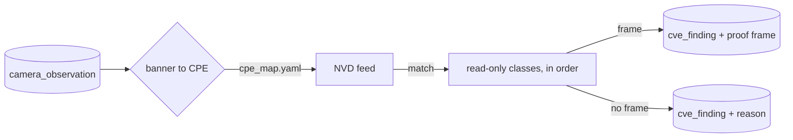

# CVE matching

Part of the [Camera Scanner](../README.md) documentation.

`scan cve` matches what a scan already stored against an NVD feed, then reads each
match once through the read-only classes of the batch. It never opens a connection
for identification, and it sends no payload.



## Build the feed

The feed is NVD 2.0 JSON. Do **not** download the full year files: hundreds of MB,
and the loader holds the whole file in memory. Pull one product subset per product
you mapped, then merge.

```bash
curl -sG 'https://services.nvd.nist.gov/rest/json/cves/2.0' \
  --data-urlencode 'virtualMatchString=cpe:2.3:o:hikvision:ds-2cd2032-i_firmware' \
  --data-urlencode 'resultsPerPage=2000' -o nvdcve-hikvision.json

jq -s '{format:"NVD_CVE", version:"2.0",
        vulnerabilities: [.[].vulnerabilities[]]}' \
  nvdcve-*.json > nvdcve-2.0.json
```

| Gotcha | Fix |
|--------|-----|
| `cpeName` answers `HTTP 404` | use `virtualMatchString` on the same endpoint |
| the API rate-limits | `sleep 6` between calls |
| matching on the hardware CPE finds nothing | a camera CVE sits on the model firmware CPE, part `o` |

A ready-made camera subset ships in `samples/nvd_camera_sample.json`.

## Map your products

`cpe_map.yaml` translates the `product` string a scan reports into a CPE. Check the
name exists in the NVD dictionary first:

```console
$ curl -sG 'https://services.nvd.nist.gov/rest/json/cpes/2.0' \
    --data-urlencode 'cpeMatchString=cpe:2.3:o:hikvision:ds-2cd2032-i_firmware' \
    --data-urlencode 'resultsPerPage=1' | jq .totalResults
1
```

`totalResults` above 0 means the name is real. `0` means it was invented and the
entry would quietly match nothing. A new product is a YAML line, never a code
change.
