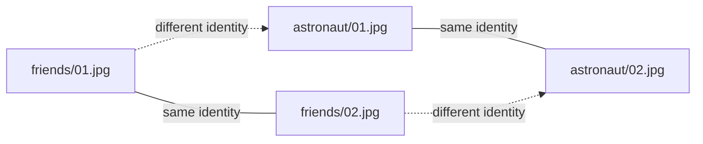

# Measure the face threshold

Part of the [Camera Scanner](../README.md) documentation.

`face.match_threshold` ships as a placeholder of `0.5`. Do not trust it until it
is measured on a labelled pair set (D16, SC-010).

The set is one directory per identity, two or more images each:

```text
logs/faces/
├── friends/
│   ├── 01.jpg
│   └── 02.jpg
└── astronaut/
    ├── 01.jpg
    └── 02.jpg
```



Every pair inside one directory is a same identity pair. Every pair across two
directories is a different identity pair.

```console
$ uv run python main.py measure threshold --pairs logs/faces
same identity        pairs 2   min 0.978  mean 0.986  max 0.993
different identity   pairs 4   min 0.039  mean 0.042  max 0.044
separation           0.934 between the largest different and the smallest same
```

```text
 0.0        0.1        0.5        0.9   0.978  1.0
  |----------|----------|----------|-----|---|
   different identity ..........  same identity
                              ^
                        put the threshold in this gap
```

The command reads only and writes nothing, including the config: a value that
changes itself is not a measured value. Pick a value in the gap, write it into
`face.match_threshold` by hand, and record the raw output and the pair set in the
front report. A directory with fewer than two images is refused with exit 1,
because one image cannot form a pair.

The run above used two identities of two images each, which shows the tool works
and does not settle a production value: two people say nothing about the pairs
that will actually be confused. Widen the set before relying on the number.
